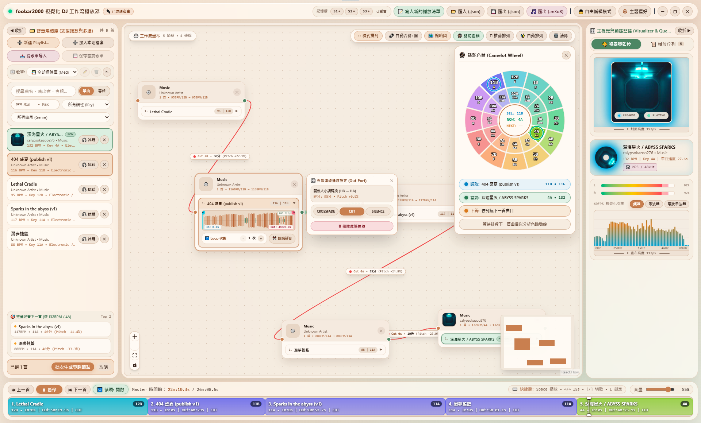

# foobar2000 視覺化 DJ 工作流播放器 (`foobar2000-dj-ui`)

基於 **NereaFantasia/foo_ui_webview2 (`foo-webview-sdk v2.2`)** 與 **React 19 + `@xyflow/react` (React Flow v12)** 打造的節點式視覺化 DJ 歌單編排、真實 PCM 音訊 DSP 分析（BPM 與 Camelot 駱駝色輪調性）、樂理諧波檢測與全局時間軸（Master Timeline）雙向同步播放器介面。



---

## 1. 專案定位與技術棧（Overview & Tech Stack）

### 1.1 核心定位
本專案旨在為桌面版 **foobar2000 v2.0+ (x64)** 提供一套非破壞性（Non-destructive）的節點式 DJ Set 視覺化編排工作台。使用者可將專輯或單曲作為圖形節點（`AlbumNode`）拖入畫布，透過有向連線（`TransitionEdge`）與卡片內部轉場設定組裝播放流程，由純函式拓撲引擎即時編譯為線性播放佇列（`FlatPlayQueueItem[]`）與全局時間軸（`MasterTimeline`），並透過 WebView2 原生 IPC 控制 foobar2000 C++ 音訊引擎進行微秒級定位（Seek）、動態音量衰減（Crossfade）、留白停頓（Silence）與零彈窗無縫切歌。

### 1.2 宿主運行環境與雙模架構
系統同時支援兩種運行環境，由 `src/api/mockBridge.ts` 的 `isFoobarWebView()` 自動偵測切換：
1. **foobar2000 原生宿主模式（Production Host Mode）**：
   - 宿主組件：`NereaFantasia/foo_ui_webview2`（注入全域 `window.fb2k.invoke` 與 `window.chrome.webview`）。
   - 打包配置：`vite.config.ts` 設定 `base: './'`，使 `npm run build` 產出的 `dist/index.html` 可直接由 WebView2 以本地檔案或開發伺服器（`http://localhost:3000`）載入。
   - 音訊與播放清單控制：透過 `foo-webview-sdk` 與 `window.fb2k.invoke` 直接操作 foobar2000 的 `library`、`playlist`、`player`、`titleformat`、`artwork` 與 `audio`（SharedBuffer PCM 解碼與 60FPS FFT 頻譜訂閱）。
2. **瀏覽器開發預覽與離線沙盒模式（Browser Mock / Sandbox Mode）**：
   - 當未偵測到 `window.fb2k` 時，自動降級為內建模擬曲庫（`MOCK_LIBRARY_TRACKS`）、模擬播放清單儲存體（`mockPlaylistsStore`）、Web Audio API 本地音訊檔案解碼，以及 60FPS 合成頻譜/VU 電平產生器。

### 1.3 關鍵依賴套件與實際用途

| 套件名稱 | 版本規格 | 在本專案中的實際工程用途 |
| :--- | :--- | :--- |
| `react` / `react-dom` | `^19.3.1` | 核心視圖層渲染與並行狀態更新 |
| `@xyflow/react` | `^12.12.1` | 節點式工作流畫布（`DJCanvas`）、自訂專輯卡片節點（`AlbumNode`）、自訂貝茲曲線轉場連線（`TransitionEdge`）與視口座標轉換（`screenToFlowPosition`） |
| `zustand` | `^5.1.0` | 四大領域狀態中心（`useWorkflowStore`、`usePlayerStore`、`usePlaylistStore`、`useThemeStore`），支援跨元件零 Props Drilling 訂閱與命令式 `getState()` 存取 |
| `foo-webview-sdk` | `^2.2.0` | 封裝 `foo_ui_webview2` C++ IPC 呼叫（播放控制、批次 Titleformat 查詢、SharedBuffer PCM 音訊解碼、全曲峰值波形提取、60FPS 頻譜串流） |
| `@tanstack/react-virtual` | `^3.14.26` | 左側智慧媒體庫（`VirtualTrackList`）的視口虛擬滾動引擎，維持大量曲目/專輯列表下的 60FPS DOM 節點複用 |
| `@dnd-kit/core` / `sortable` | `^6.3.1` / `^10.0.0` | 卡片節點內部曲目清單的拖曳排序依賴基礎（目前卡片內曲目排序與跨節點移動亦結合原生 HTML5 Drag-and-Drop MIME 通道實作） |
| `wavesurfer.js` | `^8.0.5` | 音訊波形視覺化工具依賴（微觀波形元件 `MiniWaveform` 採用 512 點 RMS 感知響度能量包絡解碼 + 98% 分位數與冪次動態對比展寬 + HiDPI `<canvas>` 物理像素對齊繪圖 + 拖曳 `IN/OUT` 時自動浮現 ±8 秒局部放大鏡 Zoom Loupe、`Shift` `0.1s` 微調與 `1.8s` 即時循環聲音預聽） |
| `tailwindcss` / `@tailwindcss/vite` | `^4.3.5` | 結合 `src/index.css` 的 `[data-theme]` 多主題變數與樣式覆寫系統，支援 **Material 3 深色、北歐晨光燕麥奶淺色雲母 (Mica)、經典霓虹暗黑、OLED 極致黑曜石** 四套面板設計 |
| `lucide-react` | `^1.71.0` | 圖示庫支援 |

---

## 2. 系統架構與資料流（System Architecture & Data Flow）

### 2.1 分層架構與雙向資料流 ASCII 圖

```text
+---------------------------------------------------------------------------------------------------+
|                                   UI Layer (src/components/*)                                     |
|                                                                                                   |
|  +------------------+   +---------------------------------------+   +--------------------------+  |
|  |   MediaLibrary   |   |            DJCanvas (ReactFlow)       |   |     VisualizerPanel      |  |
|  | - InstantSearch  |   | - AlbumNode -> MiniWaveform (Cue/Loop)|   | - VinylDisc (5-tier Art) |  |
|  | - VirtualTrack   |   | - TransitionEdge -> SettingsBox       |   | - NowPlayingInfo (LRC)   |  |
|  |   List (DnD)     |   | - CamelotWheelOverlay (24-sector SVG) |   | - VUMeter / Spectrum60fps|  |
|  +--------+---------+   +-------------------+-------------------+   +------------+-------------+  |
|           |                                 |                                    ^                |
|           | Drag & Drop / Select            | Node/Edge/Cue Mutations            | 60FPS RAF Read |
|           v                                 v                                    |                |
|  +-------------------------------------------------------------------------------+-------------+  |
|  |                         MasterTimeline (60FPS Pointer Scrubbing & Transport)                |  |
|  +--------------------------------------------------+------------------------------------------+  |
+-----------------------------------------------------|---------------------------------------------+
                                                      | Actions / Selectors
                                                      v
+---------------------------------------------------------------------------------------------------+
|                                  State Layer (src/store/* - Zustand)                              |
|                                                                                                   |
|  +------------------------+      +----------------------------+      +-------------------------+  |
|  |    usePlaylistStore    |      |      useWorkflowStore      |      |     usePlayerStore      |  |
|  | - allTracks / filtered | ---> | - nodes: Node<AlbumNode>[] | ---> | - masterTimeSeconds     |  |
|  | - selectedTrackIds     |      | - edges: Edge<TransEdge>[] |      | - trackTimeSeconds      |  |
|  | - selectedPlaylistVal  |      | - playlist: FlatPlayQueue  |      | - isPlaying / isPreview |  |
|  +-----------+------------+      +-------------+--------------+      +------------+------------+  |
+--------------|---------------------------------|----------------------------------|---------------+
               |                                 |                                  |
               | Pure Calls                      | Pure Calls                       | Pure Calls
               v                                 v                                  v
+---------------------------------------------------------------------------------------------------+
|                    Pure Algorithm & Utility Layer (src/algorithms/* & src/utils/*)                |
|                                                                                                   |
|  +------------------------+      +----------------------------+      +-------------------------+  |
|  |    autoGrouping.ts     |      |     topologicalSort.ts     |      |    harmonicMixing.ts    |  |
|  | - groupTracksByAlbum   |      | - wouldCreateCycle (DFS)   |      | - parseCamelotKey       |  |
|  | - extractSingleTrack   |      | - buildFlatPlayQueue (DAG) |      | - analyzeTransition     |  |
|  | - mergeTwoAlbumGroups  |      | - resolveMasterTimelineSeek|      | - getSuggestedNextTracks|  |
|  +------------------------+      +----------------------------+      +-------------------------+  |
|  +------------------------+      +----------------------------+      +-------------------------+  |
|  |    audioAnalyzer.ts    |      |     waveformService.ts     |      | artworkCache / Exporter |  |
|  | - Onset Flux BPM       |      | - 512-pt RMS Contrast Env  |      | - Memory + IndexedDB    |  |
|  | - 48-tone Goertzel Key |      | - WebAudio + fb.audio (v2) |      | - .json / .m3u8 Export  |  |
|  +-----------+------------+      +-------------+--------------+      +-------------------------+  |
+--------------|---------------------------------|--------------------------------------------------+
               |                                 |
               v                                 v
+---------------------------------------------------------------------------------------------------+
|                              External Bridge Layer (src/api/*)                                    |
|                                                                                                   |
|  +----------------------------------------------------+   +------------------------------------+  |
|  |                   mockBridge.ts                    |   |            websocket.ts            |  |
|  | - sendCommandToHost / subscribeToHostEvents        |   | - FoobarAudioWebSocket             |  |
|  | - playOrCueTrackOnFoobarHost (Zero-Popup Switching)|   | - fb.audio.subscribeSpectrum(60fps)|  |
|  | - syncOrderedQueueToDjPlaylistOnHost               |   | - ws://127.0.0.1:8788 fallback     |  |
|  | - jitSession (backgroundExecution: true Exemption) |   +------------------------------------+  |
|  | - setStopAfterCurrent / pauseForSilenceGap         |                                           |
|  +-------------------------+--------------------------+                                           |
+----------------------------|----------------------------------------------------------------------+
                             | window.fb2k.invoke / fb.on / SharedBuffer IPC
                             v
+---------------------------------------------------------------------------------------------------+
|                   Native Host: foobar2000 v2.x + foo_ui_webview2 (C++ Backend)                    |
+---------------------------------------------------------------------------------------------------+
```

### 2.2 核心狀態同步與時鐘推進機制（`App.tsx` 主迴圈與背景豁免）
1. **雙向橋接握手、輸出緩衝區偵測與事件訂閱**：
   - `App.tsx` 掛載時呼叫 `subscribeToHostEvents` 與 `bridgeApi.sendHandshakePing()`（自動透過 `getOutputConfig` 偵測宿主硬體輸出緩衝區秒數 `getDetectedHostBufferSec()`），並啟動 `audioStreamSocket.connect('fb2k://audio.subscribeSpectrum?fps=60&bands=64', updateAudioMeters)`。
   - 宿主事件（`HOST_PLAYBACK_STATE`、`HOST_TRACK_CHANGED`、`HOST_AUDIO_METERS`、`HOST_LIBRARY_UPDATED`、`jitSession:needNext`）透過 `window.postMessage` 或原生 IPC 轉發給 `usePlayerStore` 與 `useWorkflowStore`。
2. **背景免節流 Web Worker 時鐘 + 60FPS 視覺插值 + 雙向對時校正**：
   - `App.tsx` 在 `isPlaying || isPreviewPlaying` 為 `true` 時啟動內嵌 **Blob Web Worker**（避免背景分頁/最小化時被 Chromium 節流至 `1000ms+`），每 `100ms` 計算 `performance.now()` 真實經過秒數 `deltaSeconds` 並呼叫 `advancePlaybackTick(deltaSeconds, playlist, allTracks)`。
   - `MasterTimeline.tsx` 的 `seekhead` 透過 `requestAnimationFrame`（60FPS）呼叫 `getLiveInterpolatedMasterTime()` 在兩次 `100ms` tick 之間進行平滑子幀插值。
   - 每滿 20 個 ticks（約 2.0 秒）且未處於媒體庫試聽或 Cue 拖曳預聽時，觸發一次非阻塞的 `syncMasterTimelineWithHostPosition(playlist, allTracks)`，搭配 `0.35s` 容差死區（Deadband）防止 `seekhead` 微幅抖動。
3. **`foo_ui_webview2` `jitSession` 背景執行豁免與視窗還原防跳動**：
   - 依據 `foo-webview-sdk` 合約，當 WebView2 視窗最小化且未持有 `jitSession` 時，C++ 宿主會在 1.5 秒後呼叫 `TrySuspend()` 將渲染程序深層凍結。`mockBridge.ts` 完整實作 `jitSession.create -> prepareAdoption -> adoptNative -> setNext / release` 狀態機（含 `requestId`、`controlToken`、`contextId`、`snapshotToken`），為頁面取得 `backgroundExecution: true` 背景執行豁免權，確保視窗最小化時 Crossfade 音量曲線與 Silence 定時喚醒皆可在背景毫秒級準時運作。
   - 當視窗從最小化恢復可見（`visibilityState === 'visible'` 或 `window.focus`）時，先呼叫 `notifyWindowRestoredFromHidden()` 鎖定 `280ms` 視覺插值防跳期，再執行 `syncMasterTimelineWithHostPosition` 補齊最小化期間的跨曲目進度、專輯封面與 `seekhead` 位置。

---

## 3. 目錄結構與模組邊界（Directory Structure & Module Boundaries）

### 3.1 `src/` 目錄結構與單一職責（Single Responsibility）

```text
src/
├── types/                  # 領域模型與純型別契約（零執行期程式碼）
│   ├── track.ts            # CuePoints, InternalTransition, Track, AlbumGroup
│   ├── workflow.ts         # TransitionType, TransitionConfig, TransitionAnalysis, AlbumNodeData, FlatPlayQueueItem, WorkflowProjectFile
│   └── player.ts           # VisualizerMode, StereoVULevels, TimelineSeekTarget, HostStatus, PlayerState
├── algorithms/             # 100% 無副作用純函式演算法層（Pure Functions）
│   ├── autoGrouping.ts     # 曲目按專輯自動分組、單曲抽離為新群組、同專輯群組合併
│   ├── harmonicMixing.ts   # Camelot Key 解析、24 格色輪映射、五度圈/BPM 契合度評分、智慧推薦下一首、全局最高分起點一鍵諧波推薦排序 (recommendOptimalTrackOrder)
│   └── topologicalSort.ts  # Cycle 循環依賴偵測 (DFS)、DAG 拓撲排序編譯 FlatPlayQueue、MasterTimeline 全局時間定位與 Crossfade/Silence 計算
├── utils/                  # 獨立工具與快取服務層（DSP 計算、IndexedDB、序列化、波形提取）
│   ├── audioAnalyzer.ts    # 真實 PCM DSP 計算引擎：Onset Flux + Autocorrelation BPM 檢測、64 視窗高覆蓋率 48 半音 Goertzel + 泛音列抑制 + Krumhansl-Kessler 調性識別、非阻塞背景批次佇列
│   ├── waveformService.ts  # 512 點 RMS 感知能量包絡提取、98% 分位數與冪次動態對比展寬、首尾靜音邊界自動偵測 (detectTrackNonSilentBounds，含 0.1s Safety Margin)
│   ├── artworkCache.ts     # 記憶體 Map (0ms 同步讀取) + IndexedDB ('foobar_dj_artwork_idb_v1') 雙層真實封面快取
│   ├── colorExtractor.ts   # 離屏 32x32 Canvas 像素加權取樣，依深/淺面板主題智慧挑選高對比主色調供呼吸光暈使用
│   ├── i18nDomTranslator.ts# 基於 WeakMap 原文快照之繁中 (zh-TW) / 簡中 (zh-CN) / 英文 (en) 三語雙向字典與正則翻譯引擎（含診斷彈窗與懸停提示）
│   ├── localStorageCache.ts# 畫布 Auto-Save ('foobar2000_dj_autosave_v2') 與 3 組快速記憶槽 ('foobar2000_dj_slot_v2_1~3')，自動剝離 >4KB Base64 封面防止爆配額
│   ├── projectExporter.ts  # .json 專案序列化/結構驗證、擴充 #EXT-FOOBAR-DJ 之 .m3u8 歌單生成、三階段另存新檔對話框
│   └── formatTime.ts       # formatTime (mm:ss.d)、formatMasterClock (hh:mm:ss) 與 formatSmartDuration (1h:10m:50s / 4m:05s / 45.2s 智慧省略前導零單位) 純函式
├── api/                    # 外部通訊與宿主橋接層（Host IPC & Stream Abstraction）
│   ├── mockBridge.ts       # foo-webview-sdk / window.fb2k 雙向橋接器、jitSession 背景豁免握手、動態輸出緩衝區偵測、DJ Workflow Set 指紋快取零彈窗歌單同步与切歌、開發預覽 Mock
│   └── websocket.ts        # 60FPS 頻譜與 VU 電平串流器（優先使用 fb.audio.subscribeSpectrum 原生共享記憶體通道，支援外部 ws:// 端點與模擬串流）
├── store/                  # 全域狀態管理層（Zustand Stores）
│   ├── usePlaylistStore.ts # 左側智慧媒體庫曲目、多重篩選 (Search/BPM/Key/Genre)、Ctrl/Shift 多選、foobar2000 本機歌單切換與持久化
│   ├── useWorkflowStore.ts # React Flow 畫布 nodes/edges、拓撲重算、節點合併/拆分、單節點獨立 Cue/Loop 更新、一鍵駱駝色輪推薦排列 (autoRecommendArrangeWorkflow)、專案匯出入與自動排版
│   ├── usePlayerStore.ts   # MasterTimeline / 媒體庫 Preview / Cue 拖曳 1.8s 循環預聽隔離控制、Crossfade 增益調節、Silence 雙機制接棒喚醒、曲尾防跳回重播保護與宿主雙向對時校正
│   └── useThemeStore.ts    # 面板設計主題 (m3-dark / m3-cafe-mica / classic / oled-obsidian)、三語切換 (zh-TW / zh-CN / en)、4 段無障礙字級縮放 (100%~130%) 與側欄收折持久化
└── components/             # 視圖元件層（依領域劃分 5 大子目錄）
    ├── Header/             # HeaderBar, PresetManager, LiveLockToggle, ThemePreferencesMenu (含保留主題/語言之本地暫存清除), WindowControls, HostBridgeModal
    ├── Library/            # MediaLibrary, InstantSearch, VirtualTrackList
    ├── Canvas/             # DJCanvas, AlbumNode (含展開曲目「✂️ 跳過靜音」), MiniWaveform, TransitionEdge, TransitionSettingsBox, CamelotWheelOverlay
    ├── Visualizer/         # VisualizerPanel, VinylDisc, NowPlayingInfo, VUMeter, SpectrumCanvas
    └── Timeline/           # MasterTimeline
```

### 3.2 模組依賴規則（Dependency Direction Rules）

1. **`src/types/*`**：位於依賴樹最底層，僅允許匯入 `@xyflow/react` 的基礎型別或同目錄下的 `types/*`，**嚴禁匯入任何執行期模組**。
2. **`src/algorithms/*`**：**必須維持 100% 無副作用的純函式（Pure Functions）**。僅允許依賴 `src/types/*`。**嚴禁**在 `src/algorithms/*` 內存取 `window`、`localStorage`、`IndexedDB`、Zustand Store 或 `mockBridge`。
3. **`src/utils/*`**：提供無狀態轉換或封裝獨立的瀏覽器/宿主 I/O（如 `IndexedDB`、`localStorage`、`AudioContext`、`fb.audio`），不可反向匯入 `src/store/*` 或 `src/components/*`。
4. **`src/api/*`**：封裝所有對 `foo-webview-sdk` / `window.fb2k` 的底層呼叫，透過事件訂閱與命令介面與上層通訊，**嚴禁直接匯入 Zustand Store 或 React 元件**。
5. **`src/store/*`**：協調 `algorithms/*`、`utils/*` 與 `api/*`。其中 `useWorkflowStore` 在佇列變動時可透過 `usePlayerStore.getState()` 同步時間軸座標；`usePlaylistStore` 在曲目計算屬性更新時同步通知 `useWorkflowStore` 與 `usePlayerStore`。
6. **`src/components/*`**：僅透過 Zustand Hooks 讀取狀態與觸發 Action，或呼叫 `algorithms/*` / `utils/*` 進行純視圖衍生計算（如 `useMemo`），不在元件內直接撰寫複雜的拓撲時間軸運算。

---

## 4. 核心領域模型與資料不變量（Core Domain Models & Invariants）

### 4.1 核心領域模型（Domain Models）

- **`Track` & `CuePoints` (`src/types/track.ts`)**：
  - 每首曲目具備 `id`、`albumId`、`path`、`duration`（以宿主 `%length_seconds_fp%` 無條件捨去至 `0.1s` 十分位小數 `Math.floor(sec * 10) / 10` 對齊之精確秒數）、真實計算之 `bpm` 與 `key`（Camelot `'1A'..'12A' | '1B'..'12B'`）。
  - `cuePoints: { mixIn: number; mixOut: number; loopCount?: number }`：控制單曲在 DJ Set 中的實際進歌點、切歌點與區間循環次數（預設 `loopCount = 1`）。**各畫布卡片節點（`AlbumNode`）內的曲目擁有各自獨立的 `cuePoints` 副本**（透過 `updateTrackCuePointsInWorkflow(nodeId, trackId, nextCue)` 以 `nodeId + trackId` 精準定位），支援同一首曲目在不同節點設定不同的段落裁切與循環次數（例如 `A -> B -> B'(尾段鼓點循環 3 次) -> C`）。
  - `internalTransition?: { type: 'CROSSFADE' | 'CUT' | 'SILENCE'; duration: number }`：定義同一張專輯卡片（`AlbumNode`）內，該曲目往下一首曲目的內部過渡方式（預設 `CUT 0s`）。
- **`AlbumGroup` & `AlbumNodeData` (`src/types/track.ts`, `src/types/workflow.ts`)**：
  - `AlbumGroup` 聚合多首 `tracks: Track[]`，並衍生計算整張卡片的 `totalDuration`、`minBpm`、`maxBpm`、首曲入口（`entryBpm` / `entryKey`）與尾曲出口（`exitBpm` / `exitKey`）。
  - `AlbumNodeData` 為 React Flow 節點的 `data` 載體，包含 `label`、`albumGroup` 與控制卡片內哪些曲目展開微觀波形的 `expandedTrackIds: string[]`。
- **`TransitionEdgeData` & `TransitionAnalysis` (`src/types/workflow.ts`)**：
  - 連接兩張 `AlbumNode` 的有向邊資料，包含 `transition: TransitionConfig`（`CROSSFADE` / `CUT` / `SILENCE`，新建連線預設為 `CROSSFADE 5.0s`）以及即時計算的樂理碰撞檢測結果 `analysis: TransitionAnalysis`（`score: 0~100`、`status: 'harmonic' | 'noticeable' | 'clash'`、`suggestedPitchText`、`suggestedEdgeColor`）。
- **`FlatPlayQueueItem` (`src/types/workflow.ts`)**：
  - 由畫布 DAG 拓撲排序編譯產出的線性播放佇列項目，帶有 `order`（1-based）、`sourceNodeId`、`cuePoints`、`transitionToNext`，以及在底部全局時間軸上的精確區間 `[timelineStartSec, timelineEndSec]`。
- **`PlayerState` (`src/types/player.ts`)**：
  - 嚴格分離「底部 Master 總時間軸播放狀態（`isPlaying`、`currentTrack`、`currentQueueOrder`、`masterTimeSeconds`、`trackTimeSeconds`）」、「左側智慧媒體庫單曲試聽狀態（`isPreviewPlaying`、`previewTrackId`、`previewTrack`、`previewTimeSeconds`）」與「微觀波形 `MIX-IN / MIX-OUT` 拖曳即時 `1.8s` 循環預聽狀態（`startCueScrubPreview` / `stopCueScrubPreview`）」。

### 4.2 系統運作絕對不可違反的資料不變量（System Invariants）

1. **DAG 無環不變量與單一出入埠約束（Acyclic Linear Chain Invariant）**：
   - 畫布上的每個 `AlbumNode` 最多只能有 **1 條連出邊（Outgoing Edge）** 與 **1 條連入邊（Incoming Edge）**。建立新連線時會自動覆寫同一 `source` 或同一 `target` 上的舊連線（見 `useWorkflowStore.onConnect`），並由 `validateConnectionRule` / `wouldCreateCycle` 阻擋自我連接（`source === target`）與任何會形成循環依賴（Cycle）的連線。
2. **節點座標與佇列順序正交不變量（Position-Order Orthogonality Invariant）**：
   - `FlatPlayQueueItem[]` 的排序**完全只由「專輯卡片內部曲目順序」與「節點連線（Edges）拓撲方向」決定**，絕不隨節點在畫布上的 `(x, y)` 座標拖曳而改變（`onNodesChange` 在僅發生座標或尺寸變化時不重算拓撲佇列）。
3. **無連線時的首節點保留不變量（Single/Unconnected Queue Retention Invariant）**：
   - 當畫布存在節點但尚未建立任何有效連線（`validEdges.length === 0`）時，`buildFlatPlayQueue` 固定將第一個節點 `[nodes[0]]` 視為 `activeNodes` 排入 `flatQueue`；當使用者拖入第 2 張卡片或從第 1 張卡片抽離出新卡片但尚未拉線時，原有第 1 張卡片的佇列**絕不會被清空**，未連線的新卡片則列入 `excludedNodeIds` 直到建立連線。
4. **Cue 點邊界與跨節點隔離不變量（Cue Boundary & Per-Node Isolation Invariant）**：
   - 對於任意曲目，恆滿足 `0 <= mixIn < mixOut <= duration`，且最小有效播放跨距 `mixOut - mixIn >= 1.0s`（在 `MiniWaveform.tsx` 拖曳與 `detectTrackNonSilentBounds` 靜音裁切時強制維持至少 `2.0s` 安全間距），循環次數 `loopCount = Math.max(1, Math.floor(loopCount))`。
   - 畫布上不同節點內的相同曲目修改 `cuePoints` 或 `internalTransition` 時，必須以 `(nodeId, trackId)` 為唯一範疇獨立更新；播放佇列推進與對時亦以 `currentQueueOrder` 為第一優先索引，確保同曲目重複排程時精準對應各自的 `timelineStartSec / timelineEndSec`。
5. **曲目時長 `0.1s` 十分位無條件捨去對齊不變量（Tenth-Second Floor Duration Invariant）**：
   - 所有來自 foobar2000 宿主的浮點曲目時長（`%length_seconds_fp%` 或 `sdkTrack.duration`）統一使用 **`floorDurationToTenth`（`Math.floor(sec * 10) / 10` 無條件捨去至 `0.1s`）**，既避免了整數 `Math.floor` 丟失 `0.9s` 尾端音訊導致提早切歌，也避免了四捨五入超過實體檔案 EOF 的問題。
6. **總時間軸與 Crossfade 長度守恆不變量（Master Timeline Duration Conservation Invariant）**：
   - 由於 foobar2000 單一播放實例在同一時間點僅能解碼輸出單一音源，`CROSSFADE` 被實作為交界點 `switchSec` 前後的「前曲 Fade-Out $\rightarrow$ 中點切歌 $\rightarrow$ 下曲 Fade-In」，**不會縮減總時間軸長度**（即 `nextItem.timelineStartSec === item.timelineEndSec`）。
   - 唯有 `SILENCE` 轉場會在兩首曲目之間插入實體空白時間，使 `nextItem.timelineStartSec = item.timelineEndSec + transitionToNext.duration`。
7. **總時間軸播放、媒體庫試聽與微觀波形 Cue 預聽三軌隔離不變量（Timeline / Preview / Cue Scrub Isolation Invariant）**：
   - 點擊左側智慧媒體庫曲目僅更新 `usePlaylistStore.selectedTrack`，**絕不更動** `usePlayerStore.currentTrack` 或 `masterTimeSeconds`。
   - 點擊媒體庫「🎧 試聽」時啟動 `isPreviewPlaying = true`，右側 `VinylDisc` 與 `NowPlayingInfo` 暫時切換顯示 `previewTrack`，但右上角 `CamelotWheelOverlay` 的 `NOW` 指針與底部 `MasterTimeline` 的 `seekhead` 永遠鎖定總時間軸的 `currentTrack`，停止試聽後無縫切回。
   - 在 `MiniWaveform` 按住並拉動 `MIX-IN` 或 `MIX-OUT` 把手時，透過 `startCueScrubPreview` 獨立驅動宿主進行 `1.8s` 區間循環聲音預聽，期間自動屏蔽 `advancePlaybackTick` 與 `syncMasterTimelineWithHostPosition`，放開滑鼠（`onPointerUp`）時呼叫 `stopCueScrubPreview` 立即停止預聽並無損還原原本的 Master Timeline 播放/暫停狀態與時間軸秒數。
8. **持久化與匯出輕量化不變量（Lightweight Persistence Invariant）**：
   - `localStorage`（Auto-Save、Slot 1~3、媒體庫工作快取、播放器進度快取）與 `.json` 專案匯出檔**嚴禁儲存大於 4KB 的 Base64 封面字串（`coverUrl`）、完整波形陣列（`waveform`）或動態歌詞（`lrc`）**。真實封面統一存放於 `artworkCache.ts` 的 `IndexedDB`（`foobar_dj_artwork_idb_v1`），避免撐爆 `localStorage` 5MB 配額與 `.json` 專案檔體積。

---

## 5. 關鍵演算法與已知邊界條件（Key Algorithms & Edge Cases）

### 5.1 DAG 拓撲排序與時間軸編譯（`src/algorithms/topologicalSort.ts`）
- **Cycle 偵測（`wouldCreateCycle`）**：
  - 以深度優先搜尋（DFS）從候選連線的 `targetId` 出發遍歷既有鄰接表（Adjacency List）；若能抵達 `sourceId`，則判定會形成閉環並拒絕連線。
- **時間軸區間計算（`buildFlatPlayQueue`）**：
  - 單曲單趟有效時長：`singlePassDuration = Math.max(1, mixOut - mixIn)`。
  - 考量 Hot Loop 後的總有效時長：`effectivePlayDuration = singlePassDuration * loopCount`。
  - 每個佇列項目的時間軸區間：`timelineStartSec = currentTimelineSec`，`timelineEndSec = timelineStartSec + effectivePlayDuration`。
  - 曲目過渡來源優先序：若該曲目**不是**所屬卡片的最後一首（`!isLastTrackInNode`），讀取曲目自身的 `track.internalTransition`；若為卡片最後一首且存在下一張已連線卡片（`hasNextConnectedNode`），則讀取外部連線 `outEdge.data.transition`。

### 5.2 全局時間軸定位與三種轉場模式觸發機制（`resolveMasterTimelineSeek` & `usePlayerStore.ts`）

給定全局時間軸秒數 `globalSeconds`，`resolveMasterTimelineSeek` 按以下優先序解析出 `TimelineSeekTarget`：

1. **`SILENCE`（留白靜音過渡，上限 20 秒）**：
   - **觸發區間**：當 `nextItem.timelineStartSec > item.timelineEndSec` 且 `clampedGlobal` 落於 `[item.timelineEndSec, nextItem.timelineStartSec)` 時，回傳 `isInSilenceGap: true`、`crossfadeGain: 0`。
   - **宿主行為與雙重喚醒保障**：`usePlayerStore` 呼叫 `bridgeApi.pauseForSilenceGap()` 暫停 foobar2000 C++ 音訊輸出並立即將 VU Meter 與 64 軌頻譜歸零，同時維持前端 `isPlaying = true` 讓 `seekhead` 繼續走完空白虛線框區間。系統同時部署 `advancePlaybackTick` 與獨立的 `silenceGapWakeTimer`（直接呼叫 `seekMasterTimeline(nextItem.timelineStartSec + 0.02)`，不受視窗剛還原 `280ms` 插值鎖影響），確保無論在前台或背景最小化狀態下，Silence 時間一到必定準時喚醒宿主播放下一首曲目的 `mixIn`。
   - **硬體緩衝區預解碼與外部歌詞外掛偷跑防護（`Stop After Current` + `jitSession endOfQueue`）**：foobar2000 硬體輸出緩衝區（由 `getDetectedHostBufferSec()` 動態偵測，約 `1.0s`）會比前端聽到的時間提早讀取下一首音檔。當曲目未設定提早切出的 `mixOut`（即距離曲尾小於 `bufferGuardSec`）且下一段轉場為 `SILENCE` 時，`usePlayerStore` 與 `mockBridge` 會同步啟用 `setStopAfterCurrent(true)` 與 `jitSession.setNext({ endOfQueue: true })`，讓 foobar2000 在第 1 首歌實體 EOF 瞬間乾淨停在曲尾，**100% 阻斷 C++ 引擎與外部歌詞外掛提前載入第 2 首歌並立即停止的問題**；若使用者在背景 Silence 倒數期間或結束後打開視窗，`syncMasterTimelineWithHostPosition` 亦會透過 `silenceWallClockStartMs` 真實經過秒數無縫接棒推進至第 2 首歌。
2. **`CROSSFADE`（V 型 Fade-Out $\rightarrow$ Fade-In 過渡，上限 20 秒）**：
   - **觸發區間**：以兩曲交界點 `switchSec = nextItem.timelineStartSec`（等同於 `item.timelineEndSec`）為中心點，計算前半衰減半寬 `fadeOutHalf = Math.min(duration * 0.5, itemDuration * 0.5)` 與後半漸強半寬 `fadeInHalf = Math.min(duration * 0.5, nextItemDuration * 0.5)`。
   - **前半段 `[switchSec - fadeOutHalf, switchSec)`（Fade-Out）**：維持播放前首曲目 `item`，相對增益 `crossfadeGain` 從 `1.0` 線性衰減至中點時為 `0.0`。
   - **後半段 `[switchSec, switchSec + fadeInHalf]`（Fade-In）**：於中點 `switchSec` 無縫切入下一首曲目 `nextItem`，相對增益 `crossfadeGain` 從 `0.0` 線性爬升至結束時恢復為 `1.0`。
   - **背景執行與實際輸出音量防呆**：藉由 `jitSession` 提供的 `backgroundExecution: true` 豁免權與 Web Worker `100ms` 時鐘，即使視窗最小化至背景，Crossfade 的 `setVolume` IPC 指令仍能以 `100ms` 步進平滑調變宿主音量。宿主輸出音量恆為 `effectiveVolume = isMuted ? 0 : Math.max(0, Math.min(1, volume * crossfadeGain))`。
3. **`CUT`（硬切無縫接軌，固定 0 秒）**：
   - 當時間軸跨越 `item.timelineEndSec` 進入 `nextItem.timelineStartSec` 時，以 `gain = 1.0` 直接切入下一首曲目的 `mixIn`。
   - **雙控制器協同 Gapless 無縫切歌與曲尾防跳回保護**：當相鄰兩曲為 `CUT (0s)`、前曲未提早切出（`mixOut >= duration - bufferGuardSec`）且下曲從頭開始（`nextItem.cuePoints.mixIn <= 0.15s`）時，系統關閉 `Stop After Current` 並透過 `jitSession.setNext({ track: { playlistId, itemIndex } })` 授權 foobar2000 C++ 原生解碼器執行 **0ms Sample-Accurate 硬體級 Gapless 連播**；若當前曲目距離 `mixOut` 僅剩 $\le 1.8\text{s}$ 而宿主因 `Stop After Current` 或單曲重複設定於 EOF 停住或跳回 `pos < 1.5s`，`syncMasterTimelineWithHostPosition` 與 `advancePlaybackTick` 會立即強制推進至 `nextItem.timelineStartSec + 0.02s`，並設立 `2200ms` 的 `lastAutoTransitionAtMs` 冷卻保護期，徹底杜絕曲尾跳回該曲開頭重新播放的問題。

### 5.3 樂理諧波、拍速檢測與一鍵推薦排列演算法（`src/algorithms/harmonicMixing.ts`）
- **Camelot Wheel 圓環距離與調性評分（滿分 50 分）**：
  - `exact`（同調，如 `8A -> 8A`）：**50 分**。
  - `relative`（關係大小調，如 `8A <-> 8B`）或 `adjacent`（五度圈相鄰 $\pm 1$，如 `8A -> 7A / 9A`）：**45 分**。
  - `energy_boost`（同圈順時針 $+2$ 全音升調或 $+7$ 半音升調）：**35 分**。
  - `incompatible`（調性衝突）：**5 分**。
- **BPM 相容性與倍速/半速等效摺疊（滿分 50 分）**：
  - 自動比較 `[targetBpm, targetBpm * 2, targetBpm / 2]` 與 `sourceBpm` 的最小差距，計算相對 Pitch 調整幅度 `pitchPercent = ((bestTargetBpm - sourceBpm) / sourceBpm) * 100`。
  - $|\text{Pitch}| \le 2.0\%$ 得 **50 分**；$\le 4.0\%$ 得 **38 分**；$\le 6.0\%$ 得 **25 分**；$> 6.0\%$ 得 **5 分**。
- **三級警示判定（`analyzeTransition`）**：
  - 🟢 `harmonic` (`#10b981`)：調性非衝突、總分 $\ge 80$ 且 $|\text{Pitch}| \le 3.5\%$。
  - 🟡 `noticeable` (`#f59e0b`)：調性非衝突且 $|\text{Pitch}| \le 6.5\%$，或雖跨調但 $|\text{Pitch}| \le 2.0\%$。
  - 🔴 `clash` (`#ef4444`)：其餘嚴重撞調或拍速落差過大之組合。
- **智慧推薦下一首的兩階段備援（`getSuggestedNextTracks`）**：
  - 第一階段篩選非 `clash` 的曲目；若結果不足 `limit` 筆，第二階段自動從 `allTracks` 納入所有「Camelot 調性諧和（`exact` / `relative` / `adjacent` / `energy_boost`）但 BPM 差距 $> 6.5\%$」的曲目並標記為黃燈 `noticeable`（提示跨速混音 $\Delta\text{BPM}$），確保任何具備有效駱駝色號的曲目都不會出現空白推薦清單。
- **一鍵自動推薦排列（`recommendOptimalTrackOrder` & `useWorkflowStore.autoRecommendArrangeWorkflow`）**：
  - 點擊畫布工具列「`🪄 推薦排列`」時，會將當前畫布所有卡片節點內的曲目拆解為獨立單曲單元（完整保留各曲目原本設定好的 `cuePoints` 與 `loopCount`）。
  - 演算法以每一首曲目分別作為候選起點執行貪婪最佳路徑搜尋（在每一步挑選 `analyzeTransition` 諧波 + BPM 分數最高、且同分時 $\Delta\text{BPM}$ 最小的下一首曲目），最終選出**整條路徑累計諧波總分最高的起點序列**，自動建立單曲節點、串聯過渡連線並按當前直式/橫式方向整齊排版。

### 5.4 真實音訊 PCM DSP 分析引擎（`src/utils/audioAnalyzer.ts`）
系統嚴格不依賴音訊檔案內可能缺失或錯誤的 ID3 BPM / Key Tag，統一從真實音訊樣本計算：
1. **真實 BPM 計算（`computeRealBpmFromPcm`）**：
   - 對單聲道 PCM 以 10ms 步進計算能量包絡與一階半波整流差分（Onset Transient Flux Envelope），再於 `68 ~ 176 BPM` 區間執行自相關梳狀濾波器（Autocorrelation Comb Filter，含 2 倍與 1/2 週期諧波加權與速度感知先驗），精準收斂出真實節拍週期。
2. **真實駱駝色輪調性計算（`computeRealCamelotKeyFromPcm`）**：
   - **高覆蓋率取樣與打擊樂瞬態過濾**：在曲目中段精華區取最多 **64 個 4096 點 Hann Window 視窗**，並自動剔除能量最高的前 15% 大鼓/打擊樂瞬態暴衝視窗，避免寬頻打擊雜訊稀釋和聲純度。
   - **48 半音 Goertzel + 泛音列抑制（Harmonic Overtone Suppression）**：於 `C2 (MIDI 36)` 至 `B5 (MIDI 83)` 共 48 個半音執行 Goertzel 頻譜能量計算後，由低音往高音扣除基音產生的第 2 泛音（$+12$ 半音，權重 `0.32`）與第 3 泛音（$+19$ 半音五度泛音，權重 `0.22`），經 `Math.log1p` 對數動態壓縮後摺疊至 12-Bin Chromagram，再與混合 EDMA 現代電子/流行權重的 **Krumhansl-Kessler** 大小調模板進行皮爾森相關係數匹配，映射為 `1A ~ 12B`。
3. **快取版本與防舊秒數覆寫機制**：
   - 計算結果快取於 `localStorage`（`foobar_dj_real_pcm_analysis_v3`）。從快取還原時**僅載入 `bpm` 與 `key`，刻意忽略快取中的 `duration`**，防止舊版快取的四捨五入秒數覆寫宿主 `%length_seconds_fp%` 的 `0.1s` 精確無條件捨去秒數。

### 5.5 面板主題設計系統與高密度視覺工程（`useThemeStore.ts` & `src/index.css`）

系統內建即時無縫切換的 4 套面板設計主題（透過 `document.documentElement.dataset.theme` 驅動，狀態保存於 `localStorage['foobar2000_dj_panel_theme_v1']`）：

1. **方案 1 — Material 3 深色 • 高密緊湊 (`m3-dark`)**：
   - 採用 Google Material You 深藍灰 Tonal Surface (`#0f1218` / `#171b24`) 與柔霧藍 (`#8ab4f8`)、薄荷綠 (`#4db6ac`) 強調色。
   - **全介面 M3 膠囊化（Capsule UI）**：按鈕、搜尋框、下拉選單、單曲/專輯切換外框、BPM 範圍篩選外框、畫布連線轉場標籤，以及駱駝色輪下方 4 個狀態資訊框皆統一採用 `rounded-full` 膠囊造型。
   - **畫布視野極大化**：隱藏傳統畫布外層雙行標題列，改為畫布頂部內嵌懸浮毛玻璃膠囊控制塢（Floating Glass Dock），並支援左側智慧媒體庫與右側視覺化面板獨立收折為垂直窄條。
2. **方案 2 — 北歐晨光 • 燕麥奶雲母 (`m3-cafe-mica`)**：
   - 繼承方案 1 的 Material 3 緊湊面板與膠囊設計，融合 **Windows 11 Mica（雲母半透明漫射材質，`backdrop-filter: blur(28px) saturate(145%)`）** 與 **`Segoe UI Variable` 字體**，打造北歐咖啡館晨光下午茶氛圍。
   - **專屬淺色暖調色盤**：北歐燕麥奶背景 (`#F5EFE8`)、柔霧杏仁白卡片與次容器 (`#FFFDF9` / `#FAF4EC`)、焦糖肉桂拿鐵主強調色 (`#C87D4B`)、鼠尾草抹茶播放狀態色 (`#4E8763`) 與深焙濃縮咖啡文字 (`#2B1E17`)。
   - **全方位淺色元件適配**：包含頂部記憶槽 (`S1~S3`)、主題偏好選單標籤 (`方案 1~4`)、媒體庫單曲與 `+整張專輯` 膠囊按鈕、展開之節點轉場設定盒、512 點暖色調微觀波形、左下角杏仁白畫布縮放控制列、右側暖燕麥底 60FPS 頻譜分析儀，以及底部暖燕麥拿鐵淺色總時間軸軌道（`!bg-[#eadccf]/90` 搭配高對比深焙描邊播放指針）。
3. **方案 3 — 經典霓虹暗黑 (`classic`)** 與 **方案 4 — 極致黑曜石 (`oled-obsidian`)**：
   - 分別提供標準青藍霓虹工作室風格，以及 `#000000` 純黑零光害高對比演出模式。
4. **視覺化互動細節強化**：
   - **三語雙向切換、4 段無障礙字級與一鍵清除本地暫存 (`useThemeStore` / `ThemePreferencesMenu` / `i18nDomTranslator`)**：支援繁體中文 (`zh-TW`)、簡體中文 (`zh-CN`)、英文 (`en`) 即時雙向無損切換，並提供 `100%` ~ `130%` 四段字級放大；主題偏好視窗內建二段式確認的「`🧹 清除本地暫存資料`」功能，可清空舊版畫布、曲目與分析快取並自動保留當前的主題配色（`foobar2000_dj_panel_theme_v1`）與語言設定（`foobar2000_dj_language_v1`）後重整頁面。
   - **智慧時間單位格式化 (`formatSmartDuration`)**：於媒體庫曲目列、專輯卡片標題與曲目列、微觀波形、右側播放資訊與底部總時間軸全面採用 `1h:10m:50s`、`4m:05s`、`45.2s` 智慧單位格式（自動省略前導為 `0` 的時/分單位，單曲未滿 1 分鐘時保留 `0.1s` 小數）。
   - **原生視窗拖移與座標持久化 (`HeaderBar` & `mockBridge`)**：於原生宿主環境下，按住頂部 `HeaderBar` 空白區域或主標題（已精確隔離「🔌 預覽 / 診斷」膠囊按鈕與控制項範圍）可呼叫 `window.startDrag` 拖移視窗，並透過 `window.getBounds` / `window.setPosition` 將座標持久化於 `localStorage['foobar_dj_window_pos_v1']`。
   - **同專輯節點連線自動合併開關 (`DJCanvas` & `useWorkflowStore`)**：畫布懸浮工具列提供 `🔗 自動合併: 開 / 關` 切換（持久化於 `localStorage['foobar2000_dj_auto_merge_album_v1']`），僅控制「拉線（`onConnect`）連接相鄰同專輯節點時是否自動合併」，不影響拖曳重疊合併，且由關閉切為開啟時不追溯合併畫布上既有已連線節點。
   - **專輯封面等比例高度拉桿、慢速呼吸光暈與播放旋轉小唱片 (`VinylDisc` / `NowPlayingInfo` / `colorExtractor`)**：`VinylDisc` 採用與 `SpectrumCanvas` 一致的主題底色容器與底部高度調整拉桿（`96px` 至 `1:1` 正方形上限，封面圖片與圓角等比例縮放，持久化於 `localStorage['foobar_dj_cover_height_v1']`）；封面大圖與曲目資訊旁小唱片支援 70% 擴散、+20% 亮度與沉穩慢速呼吸發光動畫（`dj-glow-breathe` `4.8s` 週期），且 `NowPlayingInfo` 左側小唱片於播放/試聽中會同步以 `8s` 週期平滑旋轉。
   - **微觀波形 (`MiniWaveform`) 高動態 RMS 對比、精确 `0.1s` 微調、即時 `1.8s` 循環預聽與「`✂️ 跳過靜音`」自動首尾裁切**：
     - **高動態 RMS 波形（解決母帶 Brickwall Limiter 整條頂滿問題）**：`waveformService.ts` 向 `fb.audio.generateFullWaveform` 請求 `method: 'rms'` 均方根感知能量（Web Audio 採用 `78% RMS + 22% Peak`），搭配 **98% 分位數正規化**、**`Math.pow(ratio, 1.38)` 冪次對比展寬**與 **`72% 平均 + 28% 峰值` 混合降採樣**（快取鍵 `v2-rms::`），清晰呈現主歌（Verse）、副歌（Chorus）與漸弱（Breakdown）的段落高低落差。
     - **增量式拖曳、`Shift` `0.1s` 精準微調與滾輪步進**：拖曳 `MIX-IN / MIX-OUT` 時支援按住 `Shift` 鍵將滑鼠靈敏度無縫縮小至與上方 `±8s` Zoom Loupe 放大鏡完全一致的 `1:1` 比例（每移動幾像素即精準對應 `0.1s`），同時支援在 `IN / OUT` 把手與底部時間膠囊上直接滾動滑鼠滾輪進行 `±0.1s`（按住 `Shift` 為 `±1.0s`）微步進。
     - **即時 `1.8s` 循環聲音預聽**：按住並拉動 `MIX-IN` 時（`120ms` 節流），宿主即時從 `mixIn` 播放至 `mixIn + 1.8s` 並自動跳回 `mixIn` 持續循環預聽（Zoom Loupe 同步顯示青色 `LOOP [IN -> +1.8s]` 區間高亮）；按住並拉動 `MIX-OUT` 時，即時重複循環播放 `[mixOut - 1.8s, mixOut]` 切出前尾音（Zoom Loupe 同步顯示玫紅色 `LOOP [-1.8s -> OUT]` 區間高亮），直到放開滑鼠自動停止並還原總時間軸狀態。
     - **「`✂️ 跳過靜音`」一鍵首尾靜音裁切 (`detectTrackNonSilentBounds` & `AlbumNode`)**：於卡片展開曲目的「`🔁 Loop 次數`」設定框右側並排提供「`✂️ 跳過靜音`」按鈕，以低靜音偵測門檻 `Math.max(0.044, minPeak + (maxPeak - minPeak) * 0.015)` 雙向掃描 512 點 RMS 波形，並於偵測到的首尾發聲邊界外各保留 **`0.1 秒` Safety Margin**，自動將該節點曲目的 `Mix-In` 設在實際發聲處、`Mix-Out` 設在尾端剛進入靜音處。
   - **畫布圖層堆疊關係與駱駝色輪 (`CamelotWheelOverlay`) 避讓**：當點擊連線開啟「`🎛️ 外部連線過渡設定 (Out-Port)`」浮動視窗時，`DJCanvas` 透過 `displayNodes` 直接賦予該連線來源節點 React Flow 原生 `zIndex: 2000`（與行內 `style.zIndex: 2000` 及 `src/index.css` 的 `.react-flow__node:has(.dj-edge-transition-popover) { z-index: 2000 !important; }`），確保過渡設定視窗位於畫布所有節點卡片（一般 `0`、選取態 `1000`）之上；同時 `<ReactFlow>` 封裝於 `relative z-10` 獨立堆疊上下文中，確保其永遠位於 `z-30` 的駱駝色輪視窗下層。
   - **總時間軸 (`MasterTimeline`) 真實像素 (`px`) 雙向避讓與字體放大**：縮減曲目方塊行間距並將曲名放大至 `12px` (`text-xs`)、右上角駱駝色號膠囊與 Cue 資訊放大至 `11px` (`text-[11px]`)；透過 `ResizeObserver` 即時量測軌道真實像素寬度，當相鄰曲目設定 `CROSSFADE` 時，精確比對轉場半寬像素與置中膠囊標籤半寬（`22px`），僅在長歌單短轉場色塊實際侵入曲目方塊時才以真實 `px` 動態內縮文字與色號標籤，避免百分比過度留白。
   - **畫布視角持久化 (`DJCanvas`)**：自動將平移與縮放視角保存於 `localStorage['foobar_dj_canvas_viewport_v1']`，並於視窗最小化還原時精準鎖定原視角，防止觸發自動放大。

### 5.6 已知邊界條件與技術債注意事項（Known Edge Cases & Technical Debt）
經全面掃描原始碼，目前專案內無未處理之 `TODO` / `FIXME` 註記，但維護者必須留意以下架構邊界條件：
1. **`@tanstack/react-virtual` 與 React Compiler 相容性提示**：
   - 在 `src/components/Library/VirtualTrackList.tsx` 中，`useVirtualizer()` 每次 Render 會回傳新的物件參考（ESLint `react-hooks/incompatible-library` 會有 1 條預期內的 Warning）。**切勿將 `rowVirtualizer` 放進 `useEffect` 的依賴陣列中**，否則在多選曲目時會引發無限重繪與捲動死迴圈。
2. **foobar2000 零彈窗播放清單同步機制（`DJ Workflow Set` 指紋快取與防止 `addLocations`）**：
   - 在 `src/api/mockBridge.ts` 中，任何呼叫 `playlist.addItems` / `playlist.addLocations` 的操作都會觸發 foobar2000 原生 `process_locations_async` 並閃現「`Processing files`」進度視窗。因此：
     1. 畫布拓撲佇列在變動時（`recomputeTopologicalQueue`）即由背景預先呼叫 `syncOrderedQueueToDjPlaylistOnHost`，並以路徑指紋 `lastSyncedDjSetSignature` 快取同步狀態。
     2. 當使用者於播放中點擊 Master 時間軸跳轉（Seek）或從暫停狀態恢復播放時，`playOrCueTrackOnFoobarHost` 命中指紋快取後**直接對既有曲目索引執行 `playTrack` / `seek`，0 次歌單重建**；即便需新增曲目亦嚴格只走 `library.addToPlaylist`（記憶體 `metadb_handle` 注入），徹底杜絕閃現「`Processing files`」視窗。
3. **多重音軌檔（CUE / Subsong）路徑識別與隔離比對**：
   - 對於單一音訊檔內含多個 `subsong`（如整軌 CUE 映像檔）的曲目，其唯一識別 `handle` 格式為 `<path>|subsong:<N>`。在查詢 `%length_seconds_fp%` 時（`enrichAndMapSdkTracks` 與 `queryTracksExactFloorDurations`），若 `subsong > 0` 必須優先傳入含 `|subsong:N` 的 `handle`，否則宿主會回傳整張專輯檔或第一軌的時長。
   - 在 `usePlayerStore.findMatchingQueueItemFromHost` 比對宿主當前播放曲目時，若 `hostInfo.handle` 帶有 `|subsong:N` 後綴，嚴格僅以含 `|subsong:N` 的完整規範化路徑比對，並對 `|subsong:` 曲目禁用無後綴同檔名 `stem` 模糊比對，防止同張 CUE 映像檔內的多首曲目發生路徑碰撞。
4. **播放中佇列動態變動之 `seekhead` 曲目錨定與非同步對時防呆**：
   - 當播放中因抽離、刪除、合併或重排畫布節點導致總時間軸改變（例如 `A-B-[C]-D` 播放 `C` 時移除 `B` 變為 `A-[C]-D`）時，`useWorkflowStore.syncTimelineAndFoobarAfterQueueChange` 會立即同步呼叫 `usePlayerStore.reconcileTimelineOnQueueChange`，以當前實際播放曲目（`currentTrack` / 宿主播放路徑）與單曲內部進度 `trackTimeSeconds` 為錨點，重新映射該曲目在新時間軸上的 `masterTimeSeconds` 與 `currentQueueOrder`，且絕不對正在播放的曲目誤發切歌指令。
   - `mockBridge.sendCommandToHost('SYNC_PLAYLIST')` 在進入 `window.fb2k` 非同步區塊前會**同步立即更新 `latestOrderedQueuePaths`**；配合 `isHostDjPlaylistInSyncWithQueue()`，在播放期間宿主「`DJ Workflow Set`」實體清單尚未重寫前，強制停用舊 `playlistRowIndex` 索引匹配（避免舊索引 `2` 在新佇列誤指到 `D` 曲），並跳過 `matchedItem.order < currentQueueOrder` 的原生無縫跨曲逾時備援切歌。
   - `usePlayerStore` 透過 `queueReconcileEpoch` 版本鎖與 `advancePlaybackTick` 曲目錨點自癒檢查，自動攔截並捨棄任何跨越佇列變更時間點的飛行中 `queryHostPlaybackSnapshot` IPC 舊快照，並始終讀取最新的 `latestCachedFlatQueue`。

---

## 6. AI 協作規範與開發紅線（Engineering Guardrails for AI Assistants）

> **致未來在 Build 模式開啟 `New chat` 的 AI 軟體工程師**：在修改本專案任何程式碼前，請嚴格遵守以下工程紀律與紅線規範。

### 6.1 事實查核與最小化外科手術式修改（Surgical Changes Only）
- **先讀後改（Read Before Write）**：收到 Bug 回報或功能需求時，必須先實際檢索並閱讀相關檔案確認根因，嚴禁憑空猜測或盲目重構。
- **不碰無關代碼與視覺排版**：修復邏輯錯誤時，**絕對禁止**順手修改未被提及的 Tailwind CSS class、元件高寬尺寸、配色或版面結構（例如 `VinylDisc` 的 1:1 上限高度拉桿與主題底色結構、`NowPlayingInfo` 的 `shrink-0` 固定高度設計、以及浮動確認框的 `absolute top-full z-50` 零推擠定位）。
- **繁體中文維護註解**：在新增或修改的關鍵邏輯旁，請以**繁體中文**簡潔註記「造成原錯誤的原因」與「本次修改的目的」。

### 6.2 關注點分離與架構邊界紅線（Separation of Concerns）
- **純函式層零副作用**：所有拓撲排序、時間軸秒數換算、Crossfade 增益計算與樂理評分邏輯必須保留在 `src/algorithms/*` 的純函式中，**禁止**將時間軸數學公式散落寫進 React 元件內。
- **宿主 IPC 集中管理**：所有對 `foo-webview-sdk` 或 `window.fb2k` 的呼叫必須封裝於 `src/api/mockBridge.ts`、`src/api/websocket.ts`、`src/utils/audioAnalyzer.ts` 或 `src/utils/waveformService.ts`，且必須提供 `isFoobarWebView() === false` 時的瀏覽器預覽降級路徑（Fallback）。
- **禁止使用原生阻斷式彈窗**：因運行於 WebView2 與預覽 iFrame 環境，全專案**嚴禁使用 `window.alert`、`window.confirm`、`window.prompt`**，所有提示與確認步驟皆須使用元件內建的非阻斷式浮動膠囊（Toast / Popover Modal）。

### 6.3 TypeScript 型別安全規範（Strict Type Safety）
- **禁止濫用 `any`**：全專案啟用嚴格 TypeScript 編譯（`tsc -b`）。所有新增狀態、Props、IPC Payload 皆須定義明確的 `interface` 或 `type`。
- **React Flow 泛型相容**：擴充節點或連線的 `data` 型別時（如 `AlbumNodeData`、`TransitionEdgeData`），必須繼承 `Record<string, unknown>` 以符合 `@xyflow/react` v12 的泛型約束。

### 6.4 新增或修改功能的標準執行順序（Standard Modification Workflow）
每當新增或變更跨層功能時，請嚴格依照以下 4 個階段依序實作並驗證：
1. **階段 1 — 型別契約（`src/types/*.ts`）**：先定義或更新資料結構與介面契約。
2. **階段 2 — 純演算法與工具層（`src/algorithms/*.ts` & `src/utils/*.ts`）**：實作無副作用的資料轉換、時間軸運算與序列化邏輯（若涉及專案儲存，務必同步檢查 `projectExporter.ts` 與 `localStorageCache.ts`）。
3. **階段 3 — 狀態層與宿主橋接（`src/store/*.ts` & `src/api/*.ts`）**：在 Zustand Store 串接演算法與 `bridgeApi` 指令，並確保 `useWorkflowStore`、`usePlayerStore` 與 `usePlaylistStore` 三者狀態連動一致。
4. **階段 4 — 視圖元件與編譯驗證（`src/components/**/*.tsx`）**：最後更新 React 元件事件綁定與 UI 呈現，並在完成後執行 `npm run build` 與 `npm run lint` 確保 **0 TypeScript / ESLint Errors**。

---

## 7. 環境建置與開發指令（Development & Build）

本專案採用 Node.js / Vite 8 / TypeScript 6 建置，支援以下標準指令（定義於 `package.json`）：

```bash
# 1. 安裝專案依賴套件
npm install

# 2. 啟動本地開發伺服器 (預設綁定 http://0.0.0.0:3000，支援在瀏覽器或 foo_ui_webview2 中即時預覽)
npm run dev

# 3. 執行 TypeScript 嚴格型別檢查 (tsc -b) 並打包生產環境靜態檔案至 dist/
#    (已配置相對路徑 base: './'，產出之 dist/index.html 可直接掛載於 foobar2000 foo_ui_webview2 離線執行)
npm run build

# 4. 執行 ESLint 靜態程式碼語法與 React Hooks 規範檢查
npm run lint

# 5. 本地預覽已打包的 dist/ 生產環境版本
npm run preview
```
